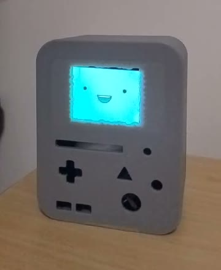
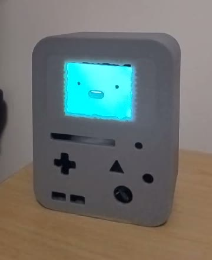
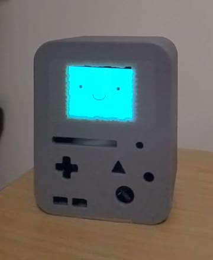
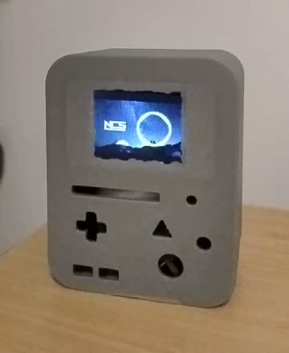

# BMO DIY

[🇬🇧 English](README.md) · **🇮🇹 Italiano**

Un assistente vocale domestico con le sembianze di **BMO**, il personaggio di *Adventure Time*, costruito su un
Raspberry Pi 3 A+. Gli parli, ti risponde a voce, ti mostra una faccia animata e sta acceso 24/7.

## Stato del progetto

| | |
|---|---|
| **Elettronica** | ✅ Completa, montata e collaudata |
| **Software** | ✅ Completo, in funzione sul Raspberry Pi |
| **Scocca stampata in 3D** | 🚧 Da realizzare: è l'ultima parte che manca ([guida](docs/stampa-3d.md)) |

## Cosa sa fare

- **Conversazione a voce**, in italiano e in inglese, con la wake word «Hey BMO» riconosciuta in locale o con il
  pulsante del HAT
- **Faccia animata** su un display da 2,4", che cambia a ogni stato e muove la bocca seguendo la voce
- **Foto**: BMO guarda con la sua fotocamera e descrive quello che vede
- **Ricerca sul web**
- **Timer** che sopravvivono ai riavvii
- **Radio via internet** e **video di YouTube** sullo schermo, con volumi separati
- **Memoria**: ricorda la conversazione in corso e tiene un diario delle tue preferenze
- **Riparte da solo** dopo uno stacco della corrente

## Le facce di BMO

| Dormiente | Sveglio | Mentre parla | Qualcosa è andato storto |
|:---:|:---:|:---:|:---:|
|  |  |  |  |

Disegni della faccia da [brenpoly/be-more-agent](https://github.com/brenpoly/be-more-agent).

## Demo

Video registrati con BMO sul Pi, ritagliati attorno a BMO. L'attesa tra la domanda e la risposta è accelerata (in
sovrimpressione il fattore, per esempio `>> x5`); domanda e risposta sono a velocità normale. Clicca un'anteprima per
aprire il video.

| Ora e meteo in italiano | Ora e meteo in inglese |
|:---:|:---:|
| [](docs/demo/bmo-time-weather-italian.mp4) | [](docs/demo/bmo-time-weather-english.mp4) |
| **Ricerca sul web: «cos'è il Politecnico di Milano?»** | **Musica da YouTube sullo schermo** |
| [](docs/demo/bmo-web-search-politecnico.mp4) | [](docs/demo/bmo-youtube-music.mp4) |

## Come funziona

Il Pi ha solo 512 MB di RAM, quindi a bordo restano wake word, audio e faccia. Trascrizione, ragionamento e visione
stanno su **Gemini**, la voce su **edge-tts**. Con il piano gratuito di Gemini il costo di esercizio è zero. Il
dettaglio è in [architettura](docs/architettura.md).

```
microfoni ─► bmo-core ─HTTPS─► Gemini, edge-tts, ricerca web, radio, YouTube
                │
           socket Unix
                ▼
            bmo-face ─SPI─► display ILI9341 da 2,4"
```

All'avvio partono tre servizi systemd: uno imposta una volta il mixer audio, gli altri due riprovano finché non sono su.

## Hardware

| Parte | Modello |
|---|---|
| Computer | Raspberry Pi 3 Model A+ con alimentatore 5 V 2,5 A |
| Memoria | microSD A1 da 32 GB |
| Audio | Waveshare WM8960 Audio HAT, con due microfoni MEMS, altoparlante da 8 Ω e un pulsante |
| Display | Waveshare 2.4" LCD Module (ILI9341, 240×320, senza touch) |
| Fotocamera | OV5647 da 5 MP con flat CSI a 15 pin |
| Montaggio | header impilabile 2×20 extra alto, cavetti F-F, viti autofilettanti M2,5×6, magneti 5×2 mm, circa 200 g di PETG |

L'elettronica costa circa 68 € oltre al Pi e al suo alimentatore, e non serve saldare. Il cablaggio, compreso l'unico
pin che conta (la retroilluminazione del display va sul **pin fisico 32**, non sul 12), è in
[`docs/hardware.md`](docs/hardware.md).

## Costruirne uno

1. **[Compra e collega l'hardware](docs/hardware.md)**: serve un Pi 3 A+, un HAT audio WM8960, un display 2.4"
   ILI9341 e una fotocamera OV5647. Nessuna saldatura.
2. **[Installa il software](docs/installazione-pi.md)**: dalla microSD vuota a BMO funzionante, con una chiave Gemini
   gratuita.
3. **[Stampa e monta la scocca](docs/stampa-3d.md)**.

Per provarlo prima, senza hardware, basta un PC Linux: [sviluppo su PC](docs/sviluppo-pc.md).

## Dove trovare le cose

| | |
|---|---|
| [`docs/`](docs/README.md) | Guide, configurazione, risoluzione dei problemi, architettura, misure |
| [`bmo-core/`](bmo-core/README.md) | Il cervello: dialogo, wake word, voce, strumenti |
| [`bmo-face/`](bmo-face/README.md) | La faccia: animazione, display SPI, finestra per il PC |
| [`pi/`](pi/README.md) | Installazione, servizi e strumenti di misura per il Raspberry Pi |

## Sviluppi futuri

Idee aperte, tracciate nelle [issue](https://github.com/riccardolanza05/bmo-diy/issues): interrompere BMO mentre parla,
Spotify Connect, domotica con Home Assistant, modalità Live di Gemini, immagini generate da mostrare sullo schermo.

## Note legali

BMO è un personaggio di *Adventure Time*, di Cartoon Network / Warner Bros. Discovery. Questo è un progetto amatoriale
non ufficiale e non commerciale, senza alcun legame con loro.

Le quattro immagini della faccia in [`docs/states/`](docs/states/) vengono da
[brenpoly/be-more-agent](https://github.com/brenpoly/be-more-agent) e sono qui solo come anteprima; l'arte completa
della faccia usata da BMO non è in questo repository. I suoni inclusi sono CC0
([dettagli](bmo-core/src/bmo_core/audio/LICENZE.md)). Modelli, librerie e modelli 3D di terze parti restano soggetti
alle proprie licenze, elencate nei [riferimenti](docs/riferimenti.md).

Questo repository non ha ancora una licenza.
