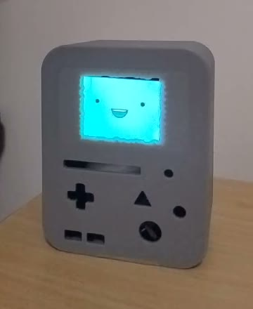
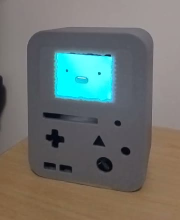
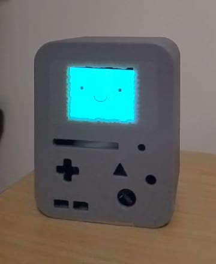
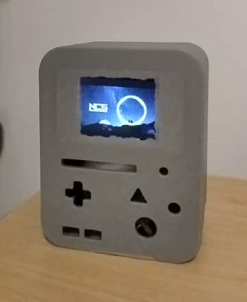

# BMO DIY

**🇬🇧 English** · [🇮🇹 Italiano](README.it.md)

A home voice assistant shaped like **BMO**, the character from *Adventure Time*, built on a Raspberry Pi 3 Model A+.
You talk to it, it answers out loud, shows an animated face and stays on 24/7.

## Project status

| | |
|---|---|
| **Electronics** | ✅ Complete, assembled and tested |
| **Software** | ✅ Complete, running on the Raspberry Pi |
| **3D-printed shell** | 🚧 To do: the last missing part ([guide, in Italian](docs/stampa-3d.md)) |

## What it does

- **Voice conversation** in Italian and English, woken by a local "Hey BMO" wake word or by the HAT button
- **Animated face** on a 2.4" display, which changes with every state and moves its mouth with the voice
- **Photos**: BMO looks through its camera and describes what it sees
- **Web search**
- **Timers** that survive reboots
- **Internet radio** and **YouTube videos** on its screen, with separate volumes
- **Memory**: it remembers the current conversation and keeps a diary of your preferences
- **Automatic restart** after a power cut

## BMO's faces

| Asleep | Awake | Speaking | Something went wrong |
|:---:|:---:|:---:|:---:|
|  |  |  |  |

Face art from [brenpoly/be-more-agent](https://github.com/brenpoly/be-more-agent).

## Demo

Clips recorded with BMO running on the Pi, cropped around BMO. The wait between the question and the answer is sped up
(the factor is shown on screen, e.g. `>> x5`); the question and the answer play at normal speed. Click a preview to
open the video.

| Time and weather, in Italian | Time and weather, in English |
|:---:|:---:|
| [](docs/demo/bmo-time-weather-italian.mp4) | [](docs/demo/bmo-time-weather-english.mp4) |
| **Web search: "what is the Politecnico di Milano?"** | **Music from YouTube on its screen** |
| [](docs/demo/bmo-web-search-politecnico.mp4) | [](docs/demo/bmo-youtube-music.mp4) |

## How it works

The Pi has only 512 MB of RAM, so only the wake word, audio and face run on the device. Speech recognition, reasoning
and vision run on **Google Gemini**, in a single call, and speech synthesis uses **edge-tts**. With Gemini's free tier
the running cost is zero. Details in [architecture (in Italian)](docs/architettura.md).

```
microphones ─► bmo-core ─HTTPS─► Gemini, edge-tts, web search, radio, YouTube
                  │
             Unix socket
                  ▼
              bmo-face ─SPI─► 2.4" ILI9341 display
```

Three systemd services start at boot: one sets up the audio mixer once, the other two keep retrying until they are up.

## Hardware

| Part | Model |
|---|---|
| Computer | Raspberry Pi 3 Model A+ with a 5 V 2.5 A power supply |
| Storage | 32 GB A1 microSD |
| Audio | Waveshare WM8960 Audio HAT, with two MEMS microphones, 8 Ω speaker and a button |
| Display | Waveshare 2.4" LCD Module (ILI9341, 240×320, no touch) |
| Camera | OV5647 5 MP with a 15-pin CSI ribbon |
| Assembly | 2×20 extra-tall stacking header, F-F jumper wires, M2.5×6 self-tapping screws, 5×2 mm magnets, about 200 g of PETG |

The parts cost about €68 on top of the Pi and its power supply, and no soldering is needed. Wiring, including the one
pin that matters (the display backlight goes on **physical pin 32**, not 12), is in [`docs/hardware.md`](docs/hardware.md).

## Build your own

The step-by-step guides are in Italian, and the commands in them are the same in any language:

1. [Hardware and wiring](docs/hardware.md)
2. [Pi installation](docs/installazione-pi.md): Raspberry Pi OS 64-bit, then `pi/irrobustisci.sh`, `pi/abilita-hat.sh`
   and `pi/deploy.sh`
3. [3D printing and assembly](docs/stampa-3d.md)

You need a free [Gemini API key](https://aistudio.google.com/apikey). The default system prompt and the voice are
Italian: both can be changed, see [`docs/configurazione.md`](docs/configurazione.md).

You can try BMO on a Linux PC without any of this hardware: see [`docs/sviluppo-pc.md`](docs/sviluppo-pc.md).

## Where to find things

| | |
|---|---|
| [`docs/`](docs/README.md) | Guides, configuration, troubleshooting, architecture, measurements |
| [`bmo-core/`](bmo-core/README.md) | The brain: dialogue, wake word, voice, tools |
| [`bmo-face/`](bmo-face/README.md) | The face: animation, SPI display, PC window |
| [`pi/`](pi/README.md) | Installation, services and measurement tools for the Raspberry Pi |

## Future work

Open ideas, tracked in the [issues](https://github.com/riccardolanza05/bmo-diy/issues): interrupting BMO while it
speaks, Spotify Connect, home automation with Home Assistant, Gemini Live mode, generated images shown on the screen.

## License

The original code, scripts and documentation of this project are released under the [MIT License](LICENSE).

These parts are **not** covered by the MIT License:

- **The BMO character.** BMO, its name, its look and *Adventure Time* belong to Cartoon Network / Warner Bros.
  Discovery. This is an unofficial, non-commercial fan project with no connection to them, and the MIT License gives
  no rights over the character. This also applies to the BMO-like face drawn by
  [`bmo-face/src/bmo_face/arte_placeholder.py`](bmo-face/src/bmo_face/arte_placeholder.py): the code is MIT, the
  character it depicts is not.
- **The face images in [`docs/states/`](docs/states/).** They come from
  [brenpoly/be-more-agent](https://github.com/brenpoly/be-more-agent), whose images have no explicit licence, and they
  depict the character above. They are shown here only as a preview; the full face art is not in this repository.
- **The demo videos in [`docs/demo/`](docs/demo/).** They show the character and the face art above.
- **The wake-word models** [`bmo-core/modelli-wake-word/`](bmo-core/modelli-wake-word/) (`bmo1.onnx`, `bmo2.onnx`).
  They were trained with the [openWakeWord](https://github.com/dscripka/openWakeWord) pipeline, whose background and
  negative datasets include non-commercial ones: use them for personal, non-commercial purposes only.
- **The bundled sounds** in [`bmo-core/src/bmo_core/audio/`](bmo-core/src/bmo_core/audio/) are third-party and
  released under CC0 1.0 ([details](bmo-core/src/bmo_core/audio/LICENZE.md)).
- **Third-party software, AI models, services and 3D models** that the project uses or points to (Gemini, edge-tts,
  openWakeWord, yt-dlp, the Printables shells, …) are not part of this repository and keep their own licences and
  terms, listed in the [references](docs/riferimenti.md).
